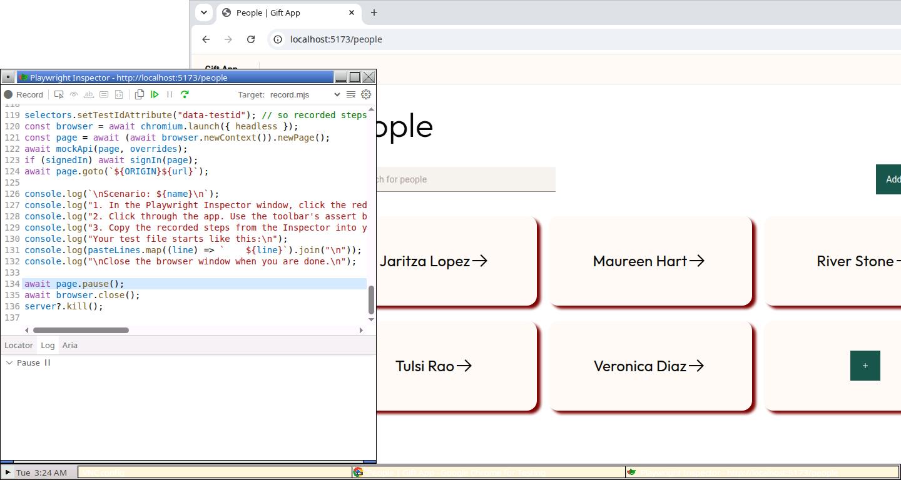
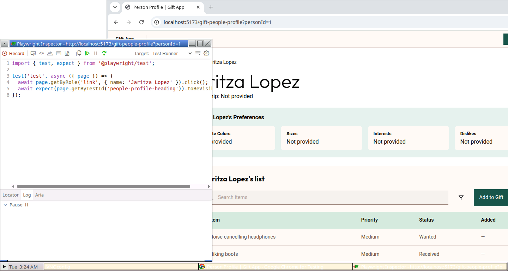

# Your Playwright tests

You will click through the app, Playwright writes the steps down, and you save them as a test. You do
not need to know how to code. How the test setup works under the hood is in [README.md](README.md),
and you do not need it to do this.

**What to do:** set up once (Part 1), record and save one practice test (Part 2), then work down the
list in Part 3.

## Part 1: Set up (once)

Recording opens a real browser window. The Codespace includes a small virtual desktop for it, which
you view in a browser tab.

1. On GitHub, open the repo, choose the branch with the tests, and create a Codespace (**Code** >
   **Codespaces** > **+**). Use a **new** Codespace: an old one does not have the desktop. If you
   must keep an old one, run **Rebuild Container** from the command palette (Ctrl+Shift+P or
   Cmd+Shift+P). The wiki's [Playwright for QA](https://github.com/Paul-Austin-Oswego-CSC480-HCI521/gift-app/wiki/Playwright-for-QA)
   page has screenshots. Setup takes a few minutes.
2. Open a terminal (**Terminal > New Terminal**) and check everything works:
   ```bash
   cd frontend
   npm run test:e2e
   ```
   You should see `8 passed`.
3. Open the virtual desktop: in the **Ports** tab at the bottom, find port **6080** ("Desktop
   (noVNC)") and click its globe icon. Click **Connect** and enter the password `vscode`. **Keep this
   tab open.**

You will use **two browser tabs** from now on: the **Codespace** (VS Code: you type commands and save
files) and the **Desktop** (where the recording happens).

## Part 2: Record your first test

This example opens a person on the People page and checks their name shows. Do it once as practice.

### Record

1. **Start the recorder.** In the Codespace terminal:
   ```bash
   npm run record -- people
   ```
   Wait about 10 seconds. The terminal prints `Scenario: people` and a block of code. Keep that code
   for later. **Do not use this terminal again until you finish.** If you need to type something, open
   a second terminal with the **+** in the terminal panel.
2. **Go to the Desktop tab.** Two windows are open:
   - the **browser**, large, showing the app already signed in as a test user. A fake server is
     behind it, so nothing you do changes real data;
   - the **Playwright Inspector**, small, at the left, on top of the browser. Ignore the code in it.

   
3. **Click Record** in the Inspector toolbar. The circle turns red. Now every click is written down.
4. **Click a person.** In the browser, click **Jaritza Lopez**. Her profile opens.
5. **Add a check.** Click the **eye icon** in the Inspector toolbar (hover over icons to see their
   names). It turns blue. Then click the heading **Jaritza Lopez** in the browser. A line starting
   with `await expect(` appears in the Inspector.

   **Every test needs at least one check.** A test with only clicks can never fail, so it proves
   nothing. The other check tools sit next to the eye: **ABC** checks an element shows given text,
   and the **cursor-in-box** icon checks a field's value.
6. **Bring the Inspector back.** Clicking in the browser puts it in front of the Inspector. Click the
   Inspector's **title bar** (the blue strip at the top, still visible at the left).
7. **Stop recording.** Click **Record** again. The circle turns grey.

   
8. **Copy only your steps.** The code panel shows a whole test:
   ```js
   import { test, expect } from '@playwright/test';      // do not copy
   test('test', async ({ page }) => {                      // do not copy
     await page.getByRole('link', { name: 'Jaritza Lopez' }).click();                   // copy
     await expect(page.getByTestId('people-profile-heading')).toBeVisible();            // copy
   });                                                     // do not copy
   ```
   Drag over the lines that start with `await` and press Ctrl+C (Cmd+C on a Mac). Do not use the copy
   icon in the toolbar: it copies everything.
9. **Get the lines into VS Code.** The Desktop tab is a separate screen, so Ctrl+V in VS Code may not
   see what you copied. Open the noVNC side panel (the small arrow tab at the left edge of the Desktop
   tab) and click the **clipboard** icon. Your lines appear in a box. Copy them from there, then paste
   in the Codespace tab. If the box stays empty, type the lines by hand: they are short.
10. **Close the browser window** (the **X** at its top right). The terminal gets its prompt back.

### Save it as a test

1. In VS Code's file list, right-click the `frontend/e2e` folder, choose **New File**, and name it
   after the feature, ending in `.spec.js`: `people-profile.spec.js`.
2. Paste the code block the terminal printed in step 1 (select it in the terminal, copy, paste).
   Every scenario prints its own block, so always use the one you were given. For this example:
   ```js
   import { test, expect, signIn, mockApi } from "./fixtures/index.js";

   test("describe what this test checks", async ({ page }) => {
     // calls lists every API request the page makes, in case a test needs to check one
     const { calls } = await mockApi(page);
     await signIn(page);
     await page.goto("/people");
     // paste the recorded steps here
   });
   ```
3. Change the text in `test("...")` to say what the test checks, in plain words. Replace the
   `// paste the recorded steps here` line with the lines you copied. The finished file:
   ```js
   import { test, expect, signIn, mockApi } from "./fixtures/index.js";

   test("shows the person's name when you open their profile", async ({ page }) => {
     // calls lists every API request the page makes, in case a test needs to check one
     const { calls } = await mockApi(page);
     await signIn(page);
     await page.goto("/people");
     await page.getByRole('link', { name: 'Jaritza Lopez' }).click();
     await expect(page.getByTestId('people-profile-heading')).toBeVisible();
   });
   ```
4. Save (Ctrl+S). In the second terminal, run only your test:
   ```bash
   npx playwright test people-profile --headed
   ```
   `--headed` shows the browser in the Desktop tab for a moment. Green and `1 passed` means it works.
   Red means a step failed, and the terminal says which line.
5. Run everything once (`npm run test:e2e`) to make sure you did not break the others.
6. Open a pull request and ask Front-End to review it.

### If something goes wrong

- **The Inspector is cut off or hidden:** click its title bar (the blue strip at the left of the
  Desktop tab).
- **I clicked and nothing was recorded:** the Record circle must be red. Clicks before that are not
  written down.
- **A step fails with "not an input" or "element is not editable"** (usually a `.fill(...)` line):
  Carbon inputs wrap the real field. Add `.locator("input")` before `.fill`:
  `await page.getByTestId("login-email-input").locator("input").fill("a@b.co");`
- **A recorded line has `.nth(2)` or a number like it:** that breaks when the list changes. Record
  that step again by clicking the item's name or button.
- **The test passes but proves nothing:** you forgot a check. Record again with the check tools.
- **`npm run record` says the app did not start:** run `npm run dev` in another terminal, wait for it
  to print an address, then run `npm run record` again.
- **Anything else:** run `npx playwright test <name> --ui` to watch the test step by step, and ask in
  the QA channel with a screenshot.
- **Never type real passwords or personal data.** The tests use a fake server and fake accounts.

## Part 3: Tests to write

These are the end-to-end user workflows QA owns. Do them in this order, easiest first. For each one: run the **Record command**, do the **Click**
steps, add the **Check** (step 5 above), then save it as in Part 2. Use the **File** name as the file
name. Several rows ask for more than one test: make one file or one `test(...)` for each.

Every test here runs against the fake server, so it works any time. To see all scenario names, run
`npm run record -- --list`.

### Easy

| # | File | Record command | Click | Check |
|---|---|---|---|---|
| 1 | `login-empty.spec.js` | `npm run record -- login` | Click **Log in** with both fields empty. | The login form is still showing. Also add the line below. |
| 2 | `login-links.spec.js` | `npm run record -- login` | Click the create account link, then that page's **Log in** link. | After each click, a heading on the new page shows. |
| 3 | `signed-out.spec.js` | `npm run record -- signed-out --url=/people` | Nothing, just open it. Repeat with `--url=/my-wishlist`, `/upcoming-dates`, `/full-preferences`, `/gift-people-profile`. | You land on the login page. One test per page. |
| 4 | `session-expired.spec.js` | `npm run record -- session-expired`, then `people-expired`, `upcoming-dates-expired`, `preferences-expired` | Nothing, just open it. | You land on the login page. One test per scenario. |
| 5 | `log-out.spec.js` | `npm run record -- dashboard` | Click the log out button. | You land on the login page. |
| 6 | `dashboard-view-all.spec.js` | `npm run record -- dashboard` | Click **View all** on People. Go back. Click **View all** on Upcoming Dates. | The People page shows, then the Upcoming Dates page shows. |
| 7 | `upcoming-dates.spec.js` | `npm run record -- upcoming-dates` | Nothing, just open it. | The three occasions show, soonest first: Jaritza's birthday, Maureen's anniversary, Jaritza's holiday. |

The line for test 1 checks that no login request was sent. Paste it after your recorded steps:

```js
expect(calls.some((call) => call.path.endsWith("/auth/login"))).toBe(false);
```

### Medium

These have a form or several steps. Do them after the Easy ones.

| # | File | Record command | Click | Check |
|---|---|---|---|---|
| 8 | `person-profile.spec.js` | `npm run record -- people` | Click the first person. | Their name and their gifts (Noise-cancelling headphones, Hiking boots) show. |
| 9 | `add-person.spec.js` | `npm run record -- people` | Click **Add person**, fill in a first and last name, save. | The new tile shows. |
| 10 | `add-gift.spec.js` | `npm run record -- dashboard` | Click **Add** on Gifts to Buy, fill in the name, choose a person, submit. | The modal closes. Also add the line below. |
| 11 | `create-account.spec.js` | `npm run record -- create-account` | Fill in first name, last name, email, password and confirm password, then submit. | You land on the login page. |
| 12 | `wishlist-add.spec.js` | `npm run record -- wishlist` | Add an item with a name and price, save. | The new row shows. |
| 13 | `preferences-save.spec.js` | `npm run record -- preferences` | Change a field, click **Save Preferences**. | The success banner shows. |

The line for test 10 checks the gift was sent to the server. Paste it after your recorded steps:

```js
expect(calls.some((call) => call.method === "POST" && call.path.endsWith("/gift/person/1"))).toBe(true);
```

**Two things to know about the fake data:**

- The dashboard (`/dashboard`) is a fixed snapshot. After you add a gift, the dashboard rows do not
  change, which is why test 10 checks the request instead.
- The dashboard's people (Alex Rivera, Sam Patel) are not the People page's people (Jaritza Lopez,
  Maureen Hart, River Stone, Tulsi Rao, Veronica Diaz).

When you finish these, tell Front-End. They will give you the next batch.
